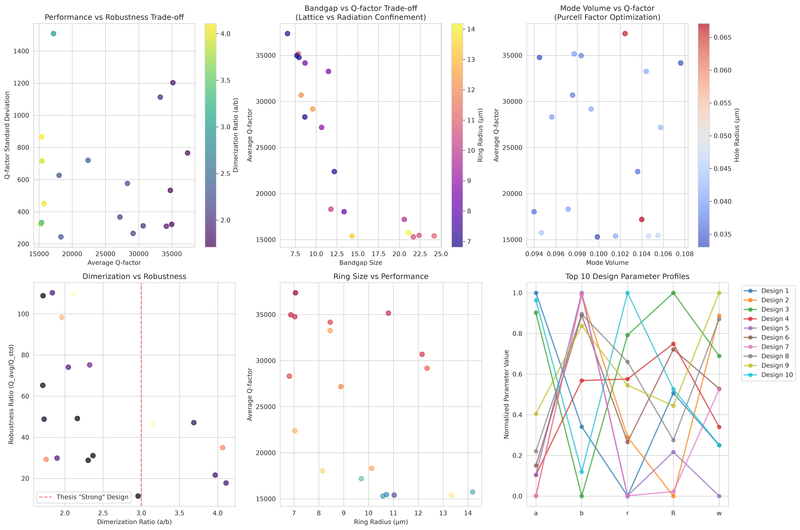

# Optimization Results Report

Results from multi-objective (NSGA-III) and single-objective (Bayesian) optimization of topological
photonic crystal ring resonators, regenerated on 2026-10-16 at commit `92a9964`. All runs are seeded
(`seed: 123`) and replay exactly.

**What these numbers are.** No electromagnetic simulation is involved. Both optimizers score designs
with analytical stand-in models in `src/simulation_wrapper.py`, and the two use **different** models:
NSGA-III uses `evaluate_design_mock`, Bayesian optimization uses `_simulate_physics_model`. Their Q
values are not on a common scale. The trade-offs below show how those models behave; real Q-factors
need the MEEP integration (see `docs/HANDOFF.md`).

Every design reported here is fabricable under the project's rule: `a` and `b` are center-to-center
hole spacings, and the gaps `a − 2r`, `b − 2r` and the edge clearance `(w − 2r)/2` must exceed the
0.05 µm minimum feature size.

---

## Table of Contents

1. [Executive Summary](#executive-summary)
2. [Parameter Space Exploration](#parameter-space-exploration)
3. [Multi-Objective Trade-off Analysis](#multi-objective-trade-off-analysis)
4. [Optimal Design Geometry](#optimal-design-geometry)
5. [Optimization Convergence](#optimization-convergence)
6. [Design Recommendations](#design-recommendations)
7. [Methodology](#methodology)

---

## Executive Summary

NSGA-III run on `configs/multi_objective_v1.yaml` (population 40, 50 generations): 2,000 designs
evaluated, 1,867 feasible, 19 on the Pareto front (`results/multi_obj_20261016_015430/`).

| Metric | Best on Pareto front | Design |
|--------|----------------------|--------|
| Q-factor (mean over disorder) | 37,361 ± 766 | Maximum Q-factor |
| Robustness ratio (Q / std) | 110.3 | Maximum robustness |
| Bandgap size (model units) | 24.18 | Maximum topological protection |
| Mode volume (model units) | 0.0940 | Minimum mode volume |

No single design is best on more than one of these: the maximum-Q design has the smallest bandgap on
the front, and the maximum-bandgap design has close to the lowest Q.

---

## Parameter Space Exploration

Six Bayesian optimization runs explore different design regimes. Details, the full results table and
an explanation of what drives each score are in [EXPLORATION_RESULTS.md](EXPLORATION_RESULTS.md).

<div align="center">


**Figure 1: Parameter Space Exploration Comparison**

</div>

- **Top row**: best score, dimerization ratio (a/b) and ring radius of each run's best design
- **Bottom row**: best hole radius, best-so-far score per evaluation, and the best (a, b) pairs

**Key findings (stand-in model):**
- The extreme-dimerization run scores highest (23,344, a/b = 4.62), more than 8,000 above any other run.
- Ring radius goes to the lower or upper bound depending on the period a + b; the model's slope in R
  changes sign near a + b ≈ 0.63 µm.
- Hole radius and waveguide width barely affect the score within the fabricable range.

---

## Multi-Objective Trade-off Analysis

<div align="center">



**Figure 2: Multi-Objective Pareto Front Analysis**

</div>

### Panel Descriptions

| Panel | X-Axis | Y-Axis | Color Scale | What it shows |
|-------|--------|--------|-------------|---------------|
| Top-left | Average Q-factor | Q-factor std dev | Dimerization ratio | Performance vs robustness |
| Top-center | Bandgap size | Average Q-factor | Ring radius | Bandgap vs Q |
| Top-right | Mode volume | Average Q-factor | Hole radius | Confinement vs Q |
| Bottom-left | Dimerization ratio | Robustness ratio | - | Dashed line: a/b = 3 thesis "strong" design |
| Bottom-center | Ring radius | Average Q-factor | - | Size vs performance |
| Bottom-right | Parameters (a, b, r, R, w) | Normalized value | Design | Top 10 designs by composite score |

**Key observations (stand-in model):**
- **Q and bandgap trade off directly.** The five designs with Q above 34,000 have bandgaps of
  6.6–8.7; the five with bandgaps above 20 have Q of 15,300–17,200. This is built into `evaluate_design_mock`: Q
  peaks when |a − b| ≈ 0.15 µm, while the bandgap grows linearly with |a − b|.
- **Smaller rings score higher Q.** Three of the five highest-Q designs, including the maximum-Q
  design, have rings of 6.9–7.1 µm, near the smallest on the front (6.8 µm). In the model, the radiation term is `1 − exp(−5/R)`, which falls as R grows, although
  the code comment says it should improve with R. Treat ring-size conclusions from this run as an
  artifact until the model is fixed or replaced by MEEP.
- **Mode volume spans only 0.094–0.108** because the model ties it to hole area and holes are limited
  to r ≤ 0.07 µm.

---

## Optimal Design Geometry

<div align="center">


**Figure 3: Best design from the 120-evaluation strong-dimerization run**

</div>

From `results/run_20261016_015430/best_design_geometry_report.md`:

| Property | Value |
|----------|-------|
| Ring radius R | 10.00 µm |
| Waveguide width w | 0.450 µm |
| Spacings a / b | 0.400 / 0.188 µm (a/b = 2.13) |
| Hole radius r | 0.041 µm (diameter 0.083 µm) |
| Total holes | 212 (106 unit cells) |
| Gap between holes at spacing b | 0.105 µm |
| Smallest printed feature | 0.083 µm (hole diameter) |

All fabrication constraints are satisfied. The SSH structure alternates spacings a and b around the
ring; the difference between them sets the dimerization that opens the topological gap.

---

## Optimization Convergence

<div align="center">


**Figure 4: Bayesian optimization of `strong_dimerization_v1` (120 evaluations)**

</div>

### Top panel: objective score
- **Blue**: score of each evaluation; **red**: best score so far.
- The best score, 12,890, first appears at evaluation 84; the remaining 35 evaluations do not improve it.
- The 14 drops to 0 are designs whose holes violate the clearance rules, scored 0 without
  simulating. Nine fall in the 20 random initial points; only five occur in the 100 guided
  evaluations after them.
- Scores include a constant −10,000 from the model's `r < 0.08 µm` penalty, which applies to every
  design in the current bounds.

### Bottom panel: parameters
- From evaluation 29 on, ring radius mostly sits at its lower bound, 10 µm (74 of 120 evaluations
  overall), with occasional exploratory jumps to the 15 µm upper bound.
- a, b, r and w are plotted on the same axis and are too small to read here; see
  `results/run_20261016_015430/optimization_log.csv`.

---

## Design Recommendations

Selected from the 19 Pareto-optimal designs by `run_multi_objective_optimization.py`
(`results/multi_obj_20261016_015430/designs/design_recommendations.yaml`). R follows from
2πR = N_cells × (a + b). "Gap" is b − 2r. Applications are the script's labels for each objective.

| Design | Intended use | a (µm) | b (µm) | r (µm) | w (µm) | N_cells | R (µm) | Gap (µm) | Q (mean ± std) | Q/std | Bandgap | Mode volume |
|---|---|---|---|---|---|---|---|---|---|---|---|---|
| Maximum Q-factor | Sensing, frequency references | 0.335 | 0.194 | 0.066 | 0.609 | 84 | 7.06 | 0.061 | 37,361 ± 766 | 48.8 | 6.56 | 0.1025 |
| Maximum robustness | High-volume manufacturing | 0.366 | 0.199 | 0.033 | 0.406 | 94 | 8.46 | 0.133 | 34,167 ± 310 | 110.3 | 8.67 | 0.1076 |
| Maximum topological protection | Topological photonics research | 0.599 | 0.146 | 0.047 | 0.469 | 93 | 11.03 | 0.052 | 15,400 ± 866 | 17.8 | 24.18 | 0.1046 |
| Minimum mode volume | Quantum optics, cavity QED | 0.446 | 0.194 | 0.036 | 0.488 | 80 | 8.15 | 0.122 | 18,030 ± 626 | 28.8 | 13.36 | 0.0940 |
| Balanced (composite score) | General purpose | 0.587 | 0.159 | 0.033 | 0.469 | 89 | 10.58 | 0.093 | 15,297 ± 325 | 47.1 | 21.68 | 0.0999 |

The maximum-robustness design gives up little Q for its robustness: 91% of the best Q, the highest
Q/std ratio and the largest hole gap of the five, though with a small bandgap (8.67). The balanced design's composite score
normalizes each objective by its maximum, which rewards its large bandgap over its low Q.

---

## Methodology

### Multi-objective optimization (`configs/multi_objective_v1.yaml`)

- **Algorithm**: NSGA-III, population 40, 50 generations, Das-Dennis reference directions
  (4 partitions, 4 objectives), seed 123
- **Variables**: a, b, r, w, N_cells, coupling gap, coupling width (R derived from N_cells)
- **Objectives**: maximize mean Q, minimize Q standard deviation, maximize bandgap, minimize mode volume
- **Constraints**: b − 2r and (w − 2r)/2 must exceed 0.05 µm, declared to pymoo so feasible designs
  always dominate infeasible ones
- **Disorder**: each design is evaluated at 8 hole-radius perturbations (5% standard deviation); the
  stand-in model applies its own 8-run disorder loop inside each evaluation

### Single-objective optimization (six configs, see EXPLORATION_RESULTS.md)

- **Algorithm**: Gaussian-process Bayesian optimization (`gp_minimize`, `gp_hedge` acquisition)
- **Score**: mean Q − 2 × Q standard deviation over 5–10 disorder runs (hole radius 4–8% std)
- **Infeasible designs**: scored 0 without simulating

### Reproduce

```bash
python run_multi_objective_optimization.py --config configs/multi_objective_v1.yaml
python run_optimization.py --config configs/strong_dimerization_v1.yaml
python src/analysis.py results/run_<TIMESTAMP>
python visualize_best_design.py results/run_<TIMESTAMP>
python compare_explorations.py
```

---

## References

- [ADVANCED_FRAMEWORK_SUMMARY.md](ADVANCED_FRAMEWORK_SUMMARY.md): technical framework documentation
- [EXPLORATION_RESULTS.md](EXPLORATION_RESULTS.md): single-objective exploration results
- [HANDOFF.md](HANDOFF.md): known issues, including the stand-in models' limitations
- [README.md](../README.md): project overview and quick start

---

*Report generated by the Topological Photonic Crystal Optimizer framework.*
